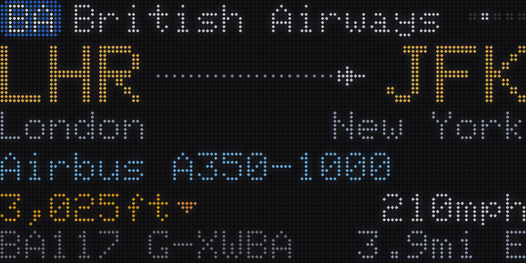
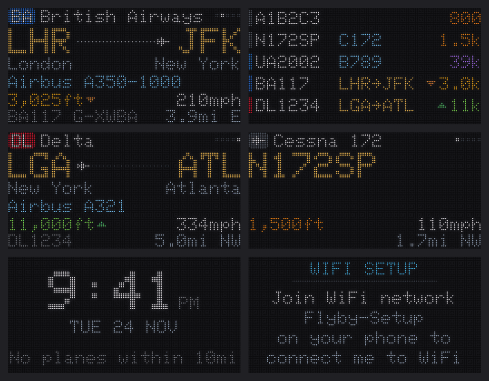

# Flyby

A 128×64 LED display that shows the planes flying over your home: airline,
route, aircraft, altitude, speed and how far away they are. It updates every
10 seconds from free community flight-tracking networks, so there's no
subscription and no API key.

It's a DIY build inspired by the
[FlightWall Mini](https://theflightwall.com/products/flightwall-mini-flight-tracking-led-display)
(same size and resolution: two 64×64 panels, about 320 × 160 mm). This
project isn't affiliated with FlightWall; the firmware here is written from
scratch.



These images come from the firmware's own drawing code. `make preview` renders
every screen with the same code that runs on the ESP32.



## What it does

- **Flights near you.** Up to 5 aircraft within your radius, nearest first.
  Show them one at a time (rotating every few seconds) or all five as a list.
- **Route and progress.** Origin and destination airports and cities, with a
  little plane moving along the line as the flight goes. Routes that can't be
  right for where the plane actually is get hidden instead of shown wrongly.
- **Aircraft details.** Airline badge in its brand colour, aircraft type
  ("Boeing 787-9"), registration, altitude (coloured by height, with a climb or
  descent arrow), ground speed, and distance and direction from you.
- **Track one flight.** Enter a flight number (`BA117`), callsign
  (`UAL2002`) or tail number (`N12345`) and it follows that flight anywhere.
- **Clock when the sky is empty**, 12 or 24 hour.
- **Night mode.** Dimmer or off between hours you choose.
- **Set up from your phone.** WiFi through a setup network, everything else on
  a web page at `http://flyby.local`. No app.

## Parts

Prices are rough and change a lot. Shop around.

| Part | Notes | Approx. |
| :- | :- | -: |
| 2 × 64×64 RGB LED panel, **P2.5**, HUB75 | 160 × 160 mm each. Search "P2.5 64x64 HUB75 RGB LED matrix". Most come with a ribbon cable and a power lead. | $20–35 each |
| ESP32 board | **Easiest:** an [ESP32 Trinity](https://github.com/witnessmenow/ESP32-Trinity), which plugs straight into the panel. **Cheapest:** any ESP32-WROOM-32 DevKit plus 14 jumper wires. | $8–35 |
| 5 V power supply, 4 A or more | Text at normal brightness draws about 1 A; full-white at full brightness could draw 8 A, so don't go below 4 A. A barrel-jack-to-screw-terminal adapter makes wiring easy. | $10–15 |
| Diffuser (optional, recommended) | 320 × 160 mm smoked/tinted acrylic, 2–3 mm. Turns harsh dots into a smooth, readable display. | $10 |
| Frame (optional) | See [Enclosure](#enclosure). | – |

Avoid the Adafruit MatrixPortal S3 for this build. The display library's
authors warn that its WiFi doesn't work well while it drives the panels.

## Wiring

### Panels

Lay the two panels face down, side by side. Each panel has an arrow on the back
showing which way data flows; both arrows should point the same way.

```
 Seen from the FRONT:

 ┌────────────────┬────────────────┐
 │   Panel 1      │   Panel 2      │      ESP32 ──ribbon──▶ Panel 1 IN
 │   x 0–63       │   x 64–127     │      Panel 1 OUT ──ribbon──▶ Panel 2 IN
 └────────────────┴────────────────┘
```

Panel 1 (the one the ESP32 plugs into) normally shows the **left** half when
you look at the front. If the two halves come out swapped, swap the panels.

Connect both panels' power leads (red = 5 V, black = GND) to the power supply.

### ESP32 Trinity

Plug it into Panel 1's input connector and power it from the same 5 V supply.
That's it. The firmware's default pins are the Trinity's.

### ESP32 DevKit with jumper wires

Wire Panel 1's 16-pin **input** connector to the ESP32. Most panels print
the signal names next to the connector; pin 1 is marked with a small triangle.
The standard layout, and the ESP32 GPIO for each signal:

```
         HUB75 input            ESP32 GPIO
       ┌───────────┐
   R1  │ 1       2 │  G1        R1 → 25    G1 → 26
   B1  │ 3       4 │  GND       B1 → 27    GND → GND
   R2  │ 5       6 │  G2        R2 → 14    G2 → 12
   B2  │ 7       8 │  E         B2 → 13    E  → 18
   A   │ 9      10 │  B         A  → 23    B  → 19
   C   │11      12 │  D         C  → 5     D  → 17
   CLK │13      14 │  LAT       CLK → 16   LAT → 4
   OE  │15      16 │  GND       OE → 15    GND → GND
       └───────────┘
```

- **E is required** for 64×64 panels. Without it only half of each panel lights.
- Connect **GND**. The ESP32 and the panels must share ground.
- Power the ESP32 over USB, or from the 5 V supply into its `5V`/`VIN` pin
  (never both at once).

Different pins? Override `PIN_*` in `platformio.ini` (see `firmware/src/Config.h`).

## Install the firmware

1. Install [VS Code](https://code.visualstudio.com/) and the
   [PlatformIO extension](https://platformio.org/install/ide?install=vscode).
2. Open the `flyby/firmware` folder in VS Code.
3. Plug the ESP32 into your computer with USB and click **Upload** (→) in the
   PlatformIO toolbar.

From a terminal instead: `cd flyby/firmware && pio run -t upload`.

If your panels use the **FM6126A** driver chip (common on P2.5 panels; the
symptom is a black or noisy screen), upload the `fm6126a` build instead:
`pio run -e fm6126a -t upload`.

## First-time setup

1. Power it on. The display says **WIFI SETUP**.
2. On your phone, join the WiFi network **Flyby-Setup**. A page opens; pick
   your home WiFi and enter its password. (2.4 GHz networks only, which is an
   ESP32 limit.)
3. The display says **ALMOST THERE** and shows an address. Open
   `http://flyby.local` (or the IP address it shows) on a phone or computer
   on the same WiFi.
4. Paste your coordinates (in Google Maps, right-click your home and click the
   numbers at the top to copy them), pick a radius, and press **Save**.

Planes show up within about 10 seconds. A 10–15 mile radius suits most homes:
planes far beyond that are hard to spot from a window.

## Settings

Everything is on `http://flyby.local`:

| Setting | |
| :- | :- |
| Coordinates, radius | Where to look, and how far. |
| Lowest / highest altitude | Hide low helicopters, or high cruise traffic you can't see. |
| Include aircraft on the ground | Off by default. Turn on if you overlook an airport. |
| Flights near me / Track one flight | Area mode, or follow one flight anywhere. |
| Layout | One flight at a time, or a list of up to 5. |
| Units | ft/mph/miles, ft/knots/nm, or m/km/h/km. |
| Clock, time zone | Clock when nothing's overhead; 12/24 hour. |
| Brightness | Day and night levels, and when night starts and ends. Night 0 turns it off. |
| Flight data source | adsb.lol (default), airplanes.live or adsb.fi. Switch if one is down. |

The page also shows a live table of what's on the display. To change WiFi
networks, use **Forget WiFi** there and set it up again.

## How it works

```
                 every 10 s                            once per new flight, cached 6 h
  ESP32 ───────────────────────▶ adsb.lol ─┐     ┌──▶ adsbdb.com
  (core 0)   "aircraft within    (positions)│     │    (route: origin, destination, airline)
             N miles of home"               ▼     │
                                 nearest 5 that pass your filters
                                            │
  ESP32 (core 1) ◀──────────────────────────┘ draws ~10 frames/s to the panels
```

- **Positions** come from [adsb.lol](https://adsb.lol),
  [airplanes.live](https://airplanes.live) or [adsb.fi](https://adsb.fi).
  These are free networks of volunteers' ADS-B receivers. Coverage is
  excellent near cities and thinner in remote areas. If you'd like to give
  back, they all welcome new receivers (a Raspberry Pi and a USB radio stick).
- **Routes** come from [adsbdb.com](https://www.adsbdb.com), looked up by
  callsign. Route databases are sometimes out of date, so the firmware checks
  that the plane is actually somewhere along the route before showing it. If
  not, it says "Route unknown" rather than showing a wrong route.
- Fetching runs in a background task on one CPU core. Drawing runs on the
  other, into an off-screen buffer; only pixels that changed are sent to the
  panels, so nothing flickers.

## Enclosure

The panels have threaded posts on the back (usually M3) and often come with
magnetic feet.

- **Simplest:** screw both panels to a 320 × 160 mm piece of 3 mm hardboard or
  plywood, with a strip across the seam so they stay flush. Add a stand, or a
  picture-hanging wire.
- **Nicer:** a shallow box frame (about 40 mm deep) with the smoked acrylic in
  front, a few millimetres off the LEDs. The gap softens each LED into a dot of
  light. Leave a slot or holes at the back for heat and the cable.
- Keep the ESP32 and power supply behind the panels, out of the light path.

## Troubleshooting

| Problem | Try |
| :- | :- |
| Screen stays black, or random noise | Upload the `fm6126a` build. Check power reaches both panels. |
| Only the top or bottom half of each panel lights | The E pin isn't connected (GPIO 18). |
| Text looks doubled or shifted by a column | Add `-DPANEL_CLKPHASE=false` to `build_flags`. |
| The two halves are swapped | Swap the panels, or swap which one the ESP32 plugs into. |
| ESP32 won't boot while plugged into the panel | GPIO 12 is a boot-mode pin. Unplug the panel, power on, then plug it in; or move G2 to another pin with `-DPIN_G2=…`. |
| Flickers or resets when bright | Power supply too small, or thin wires. Use 4 A+ and short, thick power leads. |
| "Can't reach adsb.lol" | Choose another data source on the settings page. |
| No planes, but you can see some | Increase the radius, and check the altitude filter and your coordinates (latitude first). |
| `flyby.local` doesn't open | Use the IP address shown on the display. Some Android phones don't support `.local` names. |

Serial logs: `pio device monitor` (115200 baud).

## Developing without hardware

`tools/host` builds the display and data code on a normal computer (needs a
C++17 compiler; previews need Python 3 with Pillow):

```
cd flyby/tools/host
make test       # parser, routes, units, settings and URL tests
make preview    # renders every screen to previews/*.png
```

The tests run on recorded sample responses in `tools/host/fixtures`.

### Layout

```
firmware/
  platformio.ini        build settings and pinned library versions
  src/main.cpp          startup, WiFi setup, picks what to draw
  src/FlightService.*   background fetching, route cache
  src/WebPortal.*       the settings page
  src/Display.*         HUB75 panels via the DMA library, off-screen canvas
  src/Render.*          every screen layout (shared with tools/host)
  src/FlightParser.*    feed + route JSON parsing, nearest-N selection
  src/Sources.*         API endpoints
  src/Settings.*        settings, validation;  SettingsStore.* saves them to flash
  src/Format.*, Airlines.*, AircraftNames.*, Geo.h   units, names, colours, maths
tools/host/             desktop build: tests and screen previews
```

## Ideas

- Airline logos. The ESP32 can decode small PNGs; it needs a logo source.
- A light sensor for automatic brightness.
- Over-the-air updates.
- A 3D-printable frame.
